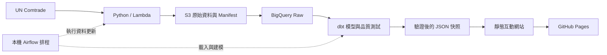

# 積體電路進口分析

以 UN Comtrade 月度貿易資料，分析主要市場的積體電路進口規模、來源國分布與跨年度變化。專案包含資料擷取、雲端倉儲、品質驗證、排程更新及互動式圖表。

**[開啟公開圖表網站](https://sunhua12.github.io/000-trade-analytics/)**，不需登入或雲端憑證。

## 可以用來看什麼

- 各市場的月度進口金額與長期變化。
- 主要來源國的進口排名、市占率與地理分布。
- 不同年度在相同月份的進口表現。
- 依市場、商品、期間與來源國篩選資料，查看明細並匯出 CSV。

網站另有資料方法頁，說明來源、指標計算與解讀限制。貿易來源國不等於晶片製造地，進口金額也不代表當地需求或產量。

## 資料範圍

| 項目 | 內容 |
| --- | --- |
| 報告市場 | 美國、中國、香港、日本、韓國、新加坡、馬來西亞、德國、荷蘭、越南 |
| 商品 | 處理器與控制器、記憶體、放大器、其他積體電路、零件 |
| HS 代碼 | 854231、854232、854233、854239、854290 |
| 頻率與單位 | 月度進口，金額為美元 |
| 歷史查核範圍 | 2016 年 1 月至 2026 年 9 月 |
| 目前快照 | 222,959 筆去重有效來源明細，最新可用資料為 2026 年 8 月 |

各市場及商品的公布進度不同；查核範圍不代表每個月份都有資料，請以網站顯示的可用月份為準。原始 HS 分類版本會保留，缺值不補為零。零件與其他商品可分別勾選。

## 資料如何進入網站



Python 在載入前檢查 checksum、資料粒度與金額精度，再以交易式分區替換更新 BigQuery。dbt 建立分析模型並執行測試，通過後才匯出 JSON。網站直接讀取快照，不會連線至 BigQuery、AWS 或後端 API。

資料更新與網站部署分開執行：Airflow 產生新快照後，仍需接受並發布該快照，公開網站才會更新。

## 專案目錄

| 路徑 | 用途 |
| --- | --- |
| `src/trade_analytics/` | 資料擷取、倉儲載入、快照驗證與匯出 |
| `dags/` | Airflow 月度更新及回補排程 |
| `dbt/` | 資料模型、參考映射與品質測試 |
| `frontend/` | 網站原始碼、圖表與前端測試 |
| `scripts/` | 管線操作、資料稽核與網站建置入口 |
| `docker/` | Airflow Compose 與容器建置設定 |
| `sql/` | BigQuery Raw 與稽核資料表初始化 |
| `docs/` | 資料契約、規格、驗證及部署說明 |
| `data/` | 本機執行產物與快照，不納入版本控制 |

## 本機預覽網站

需要 Node.js 22 以上，不需要雲端憑證。

```bash
node --test frontend/tests/*.test.mjs
node frontend/build.mjs
node frontend/serve.mjs
```

開啟 http://127.0.0.1:4173。上述指令直接使用 `frontend/public/data/` 中的正式多市場快照，與公開網站使用相同資料。測試使用獨立的 `frontend/tests/fixtures/`，不會覆蓋正式資料。

網站程式與正式資料都保存在 `main`，Pages 僅需 checkout 同一提交即可建置，不再讀取其他分支。若本機已執行完整管線，正式離線版本位於 `data/website/index.html`，可直接雙擊開啟；分檔網站版本由 `data/website/current.json` 指向。

## 網站修改與發布

1. 從 `main` 建立功能分支，修改 `frontend/`。
2. 推送分支並建立 PR，執行前端測試與正式資料建置驗證。
3. 手動合併至 `main` 後，GitHub Actions 部署網站。

合併後網站不再依賴 `gh-pages`，確認部署成功即可刪除舊分支。快照更新方式與部署條件見 [GitHub Pages 發布說明](docs/github-pages.md)。

程式與正式快照隨同一提交版本管理，並以 checksum 驗證。PR 使用獨立回歸資料執行測試，再驗證正式資料建置；部署只允許從 `main` 執行。

## 執行資料管線

需要 Python 3.11、Docker，以及可存取 AWS 和 BigQuery 的身分。僅瀏覽網站或修改前端不需要安裝此環境。

### 安裝與身分設定

```bash
python3.11 -m venv .venv
.venv/bin/python -m pip install -e '.[dev,warehouse]'
python3.11 -m venv .venv-dbt
.venv-dbt/bin/python -m pip install -r dbt/requirements.txt
cp .env.example .env
cp dbt/profiles.yml.example dbt/profiles.yml
```

在本機設定 AWS profile、S3 bucket、GCP project 與 Dataset，再登入：

```bash
set -a
source .env
set +a
aws sso login --profile "$AWS_PROFILE"
gcloud auth application-default login
```

AWS 身分需可呼叫指定 Lambda 並存取來源 S3；GCP 身分需可執行 BigQuery jobs 並寫入對應 Dataset。初次建表依序執行 [Raw tables](sql/raw-tables.sql) 與 [Load audit](sql/audit-ingestion-runs.sql)，換環境時先調整其中的 project、Dataset 及 location。

可使用公開 Comtrade API；若有 API Key，僅透過後端的 `COMTRADE_API_KEY` 設定。憑證不應放進 Git、映像檔或網站產物。

### 歷史回補與驗證

```bash
# 完整回補會寫入雲端倉儲；依配額分批處理，支援續跑。
.venv/bin/python scripts/multi_market_pipeline.py \
  --complete-backfill --start 201601 --end 202609 \
  --max-requests 1000 --max-sources 20000 --full-refresh --build --publish

# 本機驗證已產生的 JSON v2 快照。
.venv/bin/python -m trade_analytics.export.cli \
  --verify-only --output-dir data/frontend-v2

# 稽核去重有效明細與正金額筆數。
.venv/bin/python scripts/audit_multi_market.py \
  --output data/multi-market/acceptance.json
```

`--full-refresh` 用於首次建模或需要同步歷史映射的完整更新；例行更新省略此參數。`--publish` 產生本機網站產物，不會自動部署 GitHub Pages。API 截斷拆分及重試會額外消耗請求額度。

進度與驗收狀態保存在 `data/multi-market/`。S3 依市場、HS 版本、商品、月份、查詢類型與 revision 分區，保留原始版本；BigQuery Raw 保存最新接受版本，避免重跑產生重複資料。

### 月度排程

主要 DAG 為 `trade_multi_market_pipeline`，每月 15 日台北時間 04:00 檢查最近三個完整月份，並重查較早期的缺檔，以處理延遲公布及資料修訂。

- 預設完整回補驗收成功後才啟用排程。
- Airflow 必須在本機持續運行；介面為 http://localhost:8080。
- 所有管線共用單一寫入池與鎖，避免載入、建模及匯出互相交錯。
- 原有美國 HS 8542 單市場流程保留供相容操作，主要排程接手後改為手動模式。

Compose 主設定為 `docker/compose.yaml`；執行時從專案根目錄指定 `--project-directory .`，沿用 `000-trade-analytics` 專案。雲端身分掛載使用本機覆寫設定，不提交憑證。

## 品質驗證

```bash
PATH="$PWD/.venv/bin:$PATH" bash scripts/ci_checks.sh
node --test frontend/tests/*.test.mjs
```

CI 檢查 Python 格式、型別、核心測試、前端行為、DAG 載入及 Lambda 容器。前端測試涵蓋精確金額、篩選聚合、日期缺口、跨年度比較與 CSV。正式網站建置另驗證快照版本、筆數、檔案長度及 checksum。

dbt 的資料測試在 BigQuery 執行，檢查 grain、關聯、日期、分母與指標邏輯；本機測試不取代雲端驗證。驗證紀錄見 [多市場資料驗收](docs/validation/multi-market-integrated-circuits.md)。

## 解讀限制

- 各市場公布時間與資料覆蓋不同，跨市場比較可使用共同可用月份篩選。
- World 總額與國家明細分開處理；特殊代碼及未映射來源可能使國家合計小於 World。
- 缺月、缺少分母或重量不以零替代；成長率比對上一日曆月或去年同月。
- 金額以十進位字串保存，避免大型金額在 JavaScript 聚合時失去精度。
- 保留原始 HS 版本，不提供跨分類版本的等價性保證、關稅或 HTS crosswalk。
- 公開網站為已驗證的資料快照，並非即時查詢；資料公布、管線更新與網站發布可能有時間差。
- dbt 失敗會停止發布新產物，但不會自動回復已修改的倉儲模型。

## 進一步閱讀

- [多市場資料規格](docs/specs/multi-market-integrated-circuits.md)
- [資料契約](docs/data-contract.md)與[資料字典](docs/data-dictionary.md)
- [前端資料契約](docs/frontend-data-contract.md)
- [多市場資料驗收](docs/validation/multi-market-integrated-circuits.md)
- [GitHub Pages 發布說明](docs/github-pages.md)
