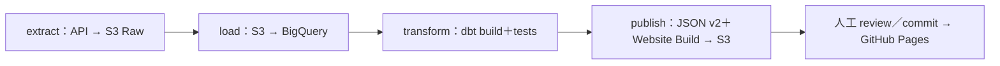

# 多市場積體電路進口分析

以 UN Comtrade 的 10 個市場、5 個 IC 六碼商品建立可重跑的 ETL，經 BigQuery、dbt 與 JSON v2 提供靜態分析網站。資料缺少與實際零值分開處理，保留原始 HS 版本。



Airflow UI 固定顯示四個 Task：`extract → load → transform → publish`。階段間僅透過 S3 成果 URI 交接，各 Task 的暫存目錄可在結束後刪除。核心分析採用 ELT：先載入 BigQuery，再由 dbt SQL 轉換。

## 執行

需要 Python 3.11、Node.js 22，以及具有 S3／BigQuery 權限的本機或 Airflow 執行環境。依 `.env.example` 設定，憑證不進入前端。

```bash
python3.11 -m venv .venv
.venv/bin/pip install -e '.[dev,warehouse]'
python3.11 -m venv .venv-dbt
.venv-dbt/bin/pip install -r dbt/requirements.txt
.venv/bin/trade-pipeline --start 202607 --end 202609 --refresh --run-id interview_demo
```

主入口 `run_pipeline()` 共用四個階段函式；完整流程將 JSON v2 與網站成品保存在 S3。預設匯出從 2016 年起至指定結束月的倉儲快照。使用固定 `--run-id` 可在換 Worker 後接續同一批擷取。

```bash
# 分批擷取，預設跳過已驗證來源。額度不足回傳 2，再次手動執行以續跑。
.venv/bin/trade-pipeline --start 201601 --end 202609 --max-requests 100 --extract-only
# 已有 Raw 時接續雲端載入、dbt、匯出。
.venv/bin/trade-pipeline --start 201601 --end 202609 --sync-only
# 獨立驗證／準備既有快照。
.venv/bin/trade-export --snapshot-root data/frontend-v2
.venv/bin/trade-export --snapshot-root data/frontend-v2 --stage-data frontend/public/data
node --test frontend/tests/*.test.mjs
node frontend/build.mjs
```

前端資料更新仍需人工 review、commit 與正常 Pages workflow 才會公開。本機 Pipeline 不會 push 或部署。

## 正確性與取捨

- 每次 HTTP 嘗試，包括 Retry 與截斷拆分，都計入請求額度。單市場仍截斷時失敗。
- 每批來源清單記錄在 S3；同批已完成來源不重抓，新批 `refresh` 才重新擷取。Manifest 是唯一 Raw 完成依據；Local 暫存目錄完整寫入後切換，S3 最後寫 Manifest。舊 Ledger 保留作歷史資料但不再讀取。
- 預設重跑沿用完整來源；`--refresh` 內容改變才遞增 Revision。刷新遺失曾成功來源會報錯。
- BigQuery 按來源完整 `DELETE＋INSERT`，交易內檢查版本與併發變更，移除新版不存在的 Partner。
- dbt 擁有金額彙總、Coverage、HHI、MoM／YoY 等業務檢查。Python 擁有 API／Raw 與 JSON 傳輸契約。
- dbt 失敗不匯出；新 JSON 完整驗證後才切換 current pointer，Pages 資料替換失敗會還原。

Airflow 每月臺北時間 15 日 04：00 刷新最近 3 個完整月份，`TRADE_MULTI_MARKET_SCHEDULE_ENABLED=true` 才啟用。歷史遲到資料以指定日期手動 `--refresh`。

## 驗證與文件

```bash
source .venv/bin/activate
bash scripts/ci_checks.sh
node --test frontend/tests/*.test.mjs
node frontend/build.mjs
```

[操作手冊](docs/runbook.md)｜[重構與驗收](docs/validation/minimal-etl.md)｜[端到端導覽](docs/pipeline.html)｜[資料契約](docs/frontend-data-contract.md)

單市場 CLI／DAG、Lambda、JSON v1 產生器及離線單檔網站已退役。既有雲端資源與 Raw 不會自動刪除。dbt 舊模型保留相容與歷史測試，現行 Pipeline 只選擇多市場模型。舊學習文件屬歷史紀錄。

`--sync-only` 僅載入指定範圍內既有、已驗證的 Raw；成功不代表指定範圍已完整擷取。缺少的來源請先執行擷取。

四階段重跑、S3 成果下載及五分鐘面試解說見 [操作手冊](docs/runbook.md)。重建 Airflow image 後才具備 Node.js 22 與新階段入口。
