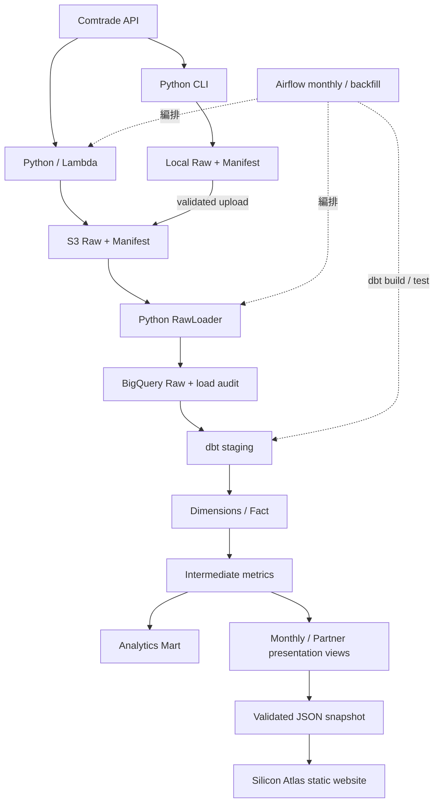
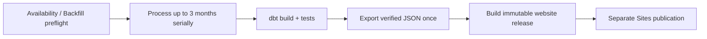

# 積體電路進口分析

目標採用方案 A：多市場、5 個積體電路子類、2016 年起月度進口資料，至少 100,000 筆去重有效明細。詳見 [正式規格](docs/specs/multi-market-integrated-circuits.md)。多市場歷史查詢、全量載入與 JSON v2 驗收已完成，共 222,959 筆有效明細；已查核 2016-01 至 2026-09，最新可用資料為 2026-08。正式離線頁面為 `data/website/index.html`，各市場實際期間見驗證紀錄。原有美國單市場流程保留供相容使用。

多市場流程分析各報告市場及五類商品的月度進口規模、來源、市占率與成長率，保留原始 HS 版本。下述原有流程仍使用美國、HS 8542 與 H6；新入口與驗收方式見本文的「多市場積體電路分析」章節。

固定 reporter 842、美國月度進口；擷取 `partner_detail` 與 `world_total`，預設展示 202301～202412。

資料擷取採 Lambda／S3；Silicon Atlas 靜態網站讀取已驗證 JSON。GitHub Actions 執行 Python、前端、DAG 與容器檢查。詳細操作見 [操作手冊](docs/runbook.md)。

## 專案架構



Python 驗證 S3 checksum、Manifest、NUMERIC 精度與 grain，再以交易式分區替換寫入 Raw。dbt 建立分析 Mart 與兩種粒度的 presentation views，通過測試後匯出 JSON 並建置完整網站版本；國家映射問題保留 audit model 以便追查。

CLI 透過 `trade-ingest` 將來源及 Manifest 寫入本機，用於除錯；入口位於 `src/trade_analytics/ingestion/cli.py`。目前 RawLoader 讀取 S3，因此 CLI 不會直接更新 BigQuery。執行方式見 [操作手冊：本機 CLI 擷取](docs/runbook.md#本機-cli-擷取)。

## 核心規格

- 十進位金額從解析到 BigQuery NUMERIC 保持精度。
- S3 保存 immutable 原檔、Manifest、checksum 與 revision，支援部分檔復原。
- Python adapter 驗證來源後，交易式替換 BigQuery Raw partition；重跑不新增重複 grain，舊 revision 不覆蓋新版。
- dbt 建立 staging、dimensions、fact、metrics、Analytics Mart 與網站展示模型。
- 指標包含市占率、MoM、YoY、HHI／覆蓋率及條件式 USD／kg。
- 匯出使用參數化 SQL、查詢量上限與快照一致性驗證；前端以精確十進位運算進行篩選聚合。
- Airflow 支援月度最近三期冪等重跑、手動單月與每批最多三個月 backfill，暫時性失敗有限重試。
- 每個核心功能保留代表測試；dbt 驗證來源契約、grain、資料保留、日期完整性、指標邏輯與映射追蹤。
- Lambda container 使用 ECR、Lambda 執行角色與基本 Logs 權限；AWS 資源手動維護。

資料身份為月份 × 查詢類型 × HS 商品 × HS 版本 × revision。來源歷史放在 S3，BigQuery Raw 保存最新接受版本。來源擷取 run_id、Raw loader 識別碼與 Airflow run_id 各有用途，不應假設相同。

## 安裝與設定

Python 3.11；Airflow、dbt 使用獨立環境。

```bash
python3.11 -m venv .venv
.venv/bin/python -m pip install -e '.[dev,warehouse]'
python3.11 -m venv .venv-dbt
.venv-dbt/bin/python -m pip install -r dbt/requirements.txt
cp .env.example .env
cp dbt/profiles.yml.example dbt/profiles.yml
```

填入 `.env` 的 AWS profile、S3 bucket、GCP project 與 Dataset；shell 操作前載入環境設定：

```bash
set -a
source .env
set +a
aws sso login --profile "$AWS_PROFILE"
gcloud auth application-default login
```

AWS 身分需可呼叫指定 Lambda 並讀取來源 S3；GCP 身分需可執行 BigQuery jobs、寫入 Raw／dbt Dataset。JSON 匯出僅需 job 權限與展示 Dataset 唯讀權限；網站訪客不需雲端憑證。憑證不放進 image 或 Git。

## 手動部署與首次建表

建立或沿用 S3、ECR、Lambda 與執行角色。Lambda 設定 `RAW_BUCKET`、`RAW_PREFIX=un_comtrade`，reserved concurrency 為 1。從專案根目錄建置 Lambda image，再手動推送至 ECR 並更新 Lambda：

```bash
docker buildx build --platform linux/amd64 --provenance=false --load \
  -f docker/Dockerfile.lambda -t trade-analytics-ingestion:local .
```

在 BigQuery 編輯器依序執行以下 SQL；已依目前本機設定填入 project、Raw Dataset 與 location。若換環境，先同步修改 SQL 與 `.env`。第一份 SQL 會建立 Raw Dataset：

1. [Raw tables](sql/raw-tables.sql)。
2. [Load audit](sql/audit-ingestion-runs.sql)。

目前載入採 Python adapter，直接驗證 S3 後以 BigQuery 暫存資料和交易式分區替換寫入 Raw，不需要共用 landing table 或 S3 Transfer。

## 單月流程

```bash
.venv/bin/python scripts/monthly_steps.py ingest --period 202412 --kind partner_detail --run-id manual-202412
.venv/bin/python scripts/monthly_steps.py ingest --period 202412 --kind world_total --run-id manual-202412
.venv/bin/python scripts/monthly_steps.py load --period 202412 --kind partner_detail
.venv/bin/python scripts/monthly_steps.py load --period 202412 --kind world_total
.venv/bin/python scripts/monthly_steps.py build --period 202412 --dbt-executable .venv-dbt/bin/dbt
```

同內容重跑驗證既有來源與 Raw snapshot，不新增重複 grain。來源修訂需明確使用下一個 `--revision`，S3 保留前版。dbt 建置涵蓋已接受 Raw 資料；回填較早月份不截掉後續月份。

## 靜態前端資料層

已新增前端專用的 `mart_dashboard_monthly` 與 `mart_dashboard_partners` dbt views，以及通過建置證據與跨檔數據驗證後產生 JSON 的匯出工具。月份摘要保留缺月與 World-only 月份，國家明細不重複月份級 World／HHI；金額與比率以十進位字串保存。

已完成靜態互動前端、Airflow 批次匯出與網站產物建置，並移除 Streamlit 程式與依賴。正式網站版本透過 Sites 發布，資料刷新與網站發布分開執行。

- [前端資料契約](docs/frontend-data-contract.md)
- [頁面草圖](docs/dashboard-wireframe.md)
- [匯出操作](docs/runbook.md#匯出靜態前端-json)
- [完整遷移計畫](docs/static-frontend-migration-plan.md)
- [真實資料驗收紀錄](docs/validation/static-data-layer.md)
- [網站與流程驗收](docs/validation/static-website.md)

## Silicon Atlas 網站

[開啟網站](https://silicon-atlas-trade-observatory.honest-badge-7365.chatgpt.site)（私人存取，需登入擁有者的 ChatGPT 帳號）。

採 Apple／Notion 風格的輕量研究工作台，提供日期／國家／Top N 篩選、趨勢、排名、YoY、覆蓋率／HHI、橘色分級地圖、跨年度月度比較、分頁明細與完整 CSV 匯出。包含獨立方法頁，說明資料來源、指標與必要限制。

可直接雙擊根目錄的 `index.html` 預覽單檔版本，不需伺服器或登入。更新單檔版本：

```bash
.venv/bin/python scripts/build_standalone.py
```

單檔內嵌樣式、程式、真實 JSON 與地圖；保留篩選、圖表與 CSV 匯出。已提交的公開快照亦可建置成分檔網站，不需 BigQuery 認證：

```bash
node --test frontend/tests/*.test.mjs
node frontend/build.mjs
node frontend/serve.mjs
```

需要 Node 22 以上；預覽位址為 http://127.0.0.1:4173。更新快照與發布步驟見 [操作手冊](docs/runbook.md#建置與發布網站)。設計取捨見 [設計紀錄](docs/design/frontend-decisions.md)。

## 本機 Airflow

首次設定、啟動、登入、Pool 設定與狀態檢查見 [操作手冊：啟動 Airflow Web UI](docs/runbook.md#啟動-airflow-web-ui)。

UI：http://localhost:8080。啟用 `trade_monthly_pipeline` 後，每月 1 日依台北時間檢查最近 3 個完整月份，依序冪等重跑可用月份。來源未提供時記錄 `not_available`。手動單月輸入 `{"period":"202412"}`；backfill DAG 輸入 `{"start_period":"202301","end_period":"202303"}`，每批最多 3 個月。

Airflow 只在本機服務運行時排程。每個 DAG 有前置檢查與 `process_batch` 兩個 task。`trade_pipeline` Pool 為單 slot；整個批次占用該 slot，直到所有月份完成 ingest／load／dbt build，再匯出一次 JSON 並建置網站產物，避免兩個 DAG 的寫入交錯。

`scripts/run_batch.py` 另以共享 `data/pipeline.lock` 的 advisory flock 保護支援的本機入口。鎖必須在同一個支援 flock 的共享檔案系統；直接執行 dbt 或自行呼叫 BigQuery 會繞過鎖，需先暫停排程。Cloud credential 只唯讀掛入 worker，XCom 僅傳 metadata。暫時性錯誤最多額外重試 3 次，重試以整批為單位，已成功的來源／Raw 依既有冪等規則重跑。

### Airflow 批次任務



實際每月均執行一次 dbt build；上圖將批次階段簡化呈現。所有選定月份成功才匯出，沒有可用月份時回傳 not_available 並保留前版。`data/website/current.json` 指向完整網站產物；這不會自動更新已發布的 Sites 網站。

## 品質檢查

```bash
PATH="$PWD/.venv/bin:$PATH" bash scripts/ci_checks.sh
```

包含 Ruff、mypy、原有核心功能及靜態 JSON 資料層的 unit tests；coverage 只輸出報告，不設百分比門檻。CI 另有真實 DAG import、Lambda Docker smoke check。dbt 的 unit／data tests 在 BigQuery 執行，可用 `scripts/test_dbt_cloud.py --help` 查看隔離 Dataset 驗證入口。

## 精簡測試範圍

Python 原有核心功能保留代表性案例，測試集中於 `test_ingestion.py`、`test_warehouse.py`；靜態資料層與批次邊界由 `test_export.py`、`test_static_pipeline.py` 驗證；另保留 1 個真實 Preview API integration test，預設跳過，以 `--run-integration` 啟用。

dbt 將原有 6 個核心 SQL 契約集中於 `assert_data_flow.sql` 與 `assert_analytics.sql`，另保留必要 grain／seed 測試，以及市占／成長／單位價值與 HHI 各一個固定輸入的 unit test。靜態資料層另有 `assert_presentation.sql`、展示模型 grain／關聯測試，以及缺月／World YoY、已確認國家篩選的 unit tests。原有部分 schema、狀態與邊界案例已移除；測試通過不代表來源全面完整。

## 驗收方式

執行 Python 品質檢查、真實 DAG import、dbt BigQuery build／tests，並驗證真實單月兩類來源與重跑、歷史月份回填後仍保留新月份，以及前端真實瀏覽器與數據核對。雲端驗收須保存真實結果，本機測試不能代替雲端驗收。

## 已知限制

- 固定美國月度進口、HS 8542／H6，預設展示 24 個月；無關稅、HTS crosswalk 或跨分類版本比較。
- Preview API 有限流與截斷檢查；空資料與永久失敗分開處理。
- S3 保留 immutable 原檔，Raw 僅保存最新接受版本與 load audit；不建立完整 warehouse history。
- Lambda concurrency、Airflow Pool 設為 1；手動操作不得與 DAG 交錯。
- Monthly 每次冪等重跑最近 3 個完整月份；更早期需人工 backfill，來源修訂需明確指定 revision。
- Airflow 只在本機服務運行時排程，`catchup=False` 不自動補完停機期間。
- dbt build／test 失敗不會自動回復 warehouse 模型，但不會更新網站發布版本；JSON 與網站產物保留上一版指標。
- 來源缺月、無 World 分母或重量缺失以 NULL／覆蓋資訊呈現。HHI 使用 World 分母，必須搭配國家覆蓋率；分母無效時為 NULL。USD／kg 不是晶片單顆價格。
- 展示範圍最多 60 個月。批次更新會延伸至最新處理月份並保留既有上界；舊年份回填不縮短範圍。
- AWS 手動部署，沒有 IaC 重建或 GitHub 雲端部署流程；瘦身未改動現有雲端服務。

詳細欄位與資料規則見 [資料契約](docs/data-contract.md)及 [資料字典](docs/data-dictionary.md)。dbt 保留 unique、not_null、relationships、grain、指標邏輯與國家映射追蹤。

## 五分鐘展示流程

1. 說明 Comtrade → Lambda／S3 → BigQuery Raw → dbt → JSON → Silicon Atlas，Airflow 串接流程。
2. 在網站選定月份與來源國，展示金額、市占率、YoY 與 HHI，搭配國家覆蓋率說明限制。
3. 以固定 BigQuery 查詢核對一個數字，不將圖表觀察當成因果。
4. 展示同月安全重跑：S3 checksum 穩定、Raw grain 不重複，dbt 重新建立 Mart。
5. 說明 Manifest、revision、load audit 與 Airflow log 如何協助排查；dbt tests 失敗會停止流程，但不提供模型自動 rollback。

僅展示目前已實測的資料與結果。三項分析觀察須自行保存查詢條件及證據。


## 多市場積體電路分析（JSON v2）

多市場入口為 `scripts/multi_market_pipeline.py`；原有美國 HS 8542 流程仍保留。
報告市場包含美國、中國、香港、日本、韓國、新加坡、馬來西亞、德國、荷蘭與越南。
商品為 854231、854232、854233、854239 與 854290（零件），歷史範圍自 2016 年 1 月起。

```bash
# 使用公開 API；遇到額度限制會遵守 Retry-After，檔案及進度可以續跑。
.venv/bin/python scripts/multi_market_pipeline.py \
  --complete-backfill --start 201601 --end 202609 \
  --max-requests 1000 --max-sources 20000 --full-refresh --build --publish

# 本機驗證目前的 JSON v2 快照，不需雲端連線。
.venv/bin/python -m trade_analytics.export.cli \
  --verify-only --output-dir data/frontend-v2

# 去重有效明細及正金額筆數；不計 World、特殊彙總與歷史副本。
.venv/bin/python scripts/audit_multi_market.py \
  --output data/multi-market/acceptance.json
```

首次遷移使用 `--full-refresh` 建立新模型；後續月份省略此參數，只替換本次受影響的月份分區。國家或商品參考映射變動時，另做一次完整更新以同步既有資料。
`--max-requests` 限制每批邏輯查詢；截斷拆分與重試會另外呼叫 API。
完整模式會持續處理下一批，並以至少 100,000 筆有效來源明細作為正式輸出門檻。
若只需要檢查目前資料，可使用 `--sync-only --build --publish`，畫面會標示未達筆數門檻的狀態。

進度位於 `data/multi-market/pipeline-state.json`，成功來源與雲端檢查點分別位於
`batch-ledger.json` 與 `cloud-ledger.json`。原始檔使用
`v3/reporter_code=.../hs_version=.../cmd_code=.../period=.../query_type=.../revision=...`，
避免市場分區互相覆蓋；原始檔契約版本與公開 JSON 版本分開管理。

正式離線成品為 `data/website/index.html`，版本化網站與資料位於
`data/website/` 及 `data/frontend-v2/`。公開 JSON 與離線成品不含 API Key。
可選的 `COMTRADE_API_KEY` 僅供後端使用，請透過本機環境或秘密管理機制設定。

新月度 DAG 為 `trade_multi_market_pipeline`，共用原有 `trade_pipeline` 寫入池，
啟用後每月 15 日台北時間 04:00 優先檢查最近三個完整月份，並依最久未檢查的順序重查歷史缺檔，以處理延遲公布。
預設 `TRADE_MULTI_MARKET_SCHEDULE_ENABLED=auto`：完整回補流程成功寫入驗收狀態後，
新 DAG 才會自動取得月度排程。可設為 `false` 明確停用，或設為 `true` 手動啟用。
月度執行使用獨立狀態檔，且正式輸出同樣要求至少 100,000 筆有效明細。
新排程接手後，原有美國單市場 DAG 自動改為手動模式，避免兩版展示互相替換。

詳細契約與驗收說明見 [多市場驗證紀錄](docs/validation/multi-market-integrated-circuits.md)。
