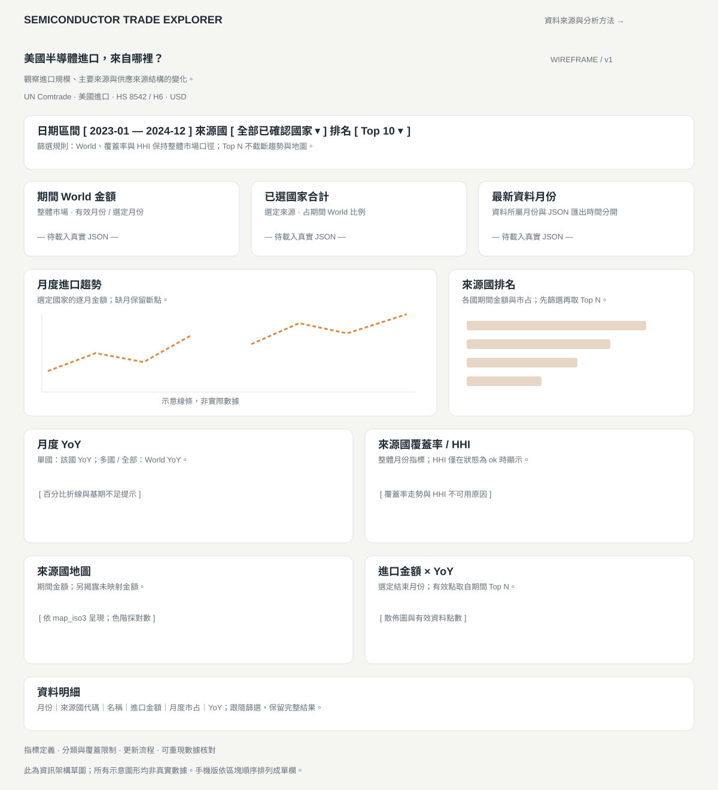

# 半導體進口分析網站：頁面草圖

這是資訊架構草圖，尚未建立正式前端。欄位與計算規則以 `frontend-data-contract.md` 為準。



## 桌面版

```text
┌──────────────────────────────────────────────────────────────┐
│ SEMICONDUCTOR TRADE EXPLORER                 資料與分析方法   │
├──────────────────────────────────────────────────────────────┤
│ 美國半導體進口，來自哪裡？                                    │
│ 觀察進口規模、主要來源與供應來源結構的變化                    │
│ UN Comtrade · 美國進口 · HS 8542／H6 · USD                    │
├──────────────────────────────────────────────────────────────┤
│ 起始月份 [2023-01 ▼]  結束月份 [2024-12 ▼]                    │
│ 來源國 [全部／多選 ▼]              排名 [Top 10 ▼]            │
│ 選取範圍摘要／缺月提示                                       │
├──────────────────┬──────────────────┬────────────────────────┤
│ 期間 World 金額  │ 已選國家合計     │ 最新資料月份           │
│ USD …            │ USD …            │ YYYY-MM                │
│ 有效／選定月數   │ 占期間 World …%  │ JSON 匯出時間 …        │
├───────────────────────────────────┬──────────────────────────┤
│ 月度進口趨勢                      │ 來源國排名               │
│ 選定國家的每月金額                 │ 期間 Top N 水平長條      │
│ 折線／缺月斷點                    │ 名稱、金額、期間市占     │
├───────────────────────────────────┼──────────────────────────┤
│ 月度 YoY                          │ 來源國覆蓋率／HHI        │
│ 單國：該國；多國：World            │ 整體月份指標，不隨國家變 │
│ 百分比、基期不足提示               │ HHI 不可用時顯示原因     │
├───────────────────────────────────┼──────────────────────────┤
│ 來源國地圖                        │ 進口金額 × YoY           │
│ 期間進口金額／對數色階             │ 選定結束月份的散佈圖     │
│ 無地圖碼金額提示                   │ 僅顯示有效資料點         │
├──────────────────────────────────────────────────────────────┤
│ 資料明細：月份、代碼、名稱、金額、市占、YoY                   │
│ 跟隨日期／國家篩選；提供完整明細，不只 Top N                 │
├──────────────────────────────────────────────────────────────┤
│ 指標定義／來源連結／分類與覆蓋限制／資料更新方式              │
│ 可重現數據核對範例與專案資料流程                             │
└──────────────────────────────────────────────────────────────┘
```

## 手機版

依桌面區塊順序改為單欄：主視覺 → 篩選 → KPI → 趨勢 → 排名 → YoY → 覆蓋率／HHI → 地圖 → 散佈圖 → 明細 → 方法說明。表格可水平捲動，篩選文字與數值單位必須完整可見。

## 互動與畫面狀態

- 未選國家表示全部已確認國家；單一國家與多選在 YoY 區塊有不同的明確標題。
- World KPI、覆蓋率與 HHI 固定代表整體範圍，旁邊標示「整體市場」，避免誤以為跟隨國家多選。
- 無資料顯示原因與目前篩選條件；缺月保留圖表斷點，不以 0 代替。
- HHI 不可用時顯示覆蓋率與原因，不展示偏低的 hhi_raw。
- 載入中、檔案載入失敗、版本不支援有獨立狀態；數據未就緒時不顯示假造 KPI。
- 最新資料月份與匯出時間分開標示，避免讀者誤認為即時資料。
- Top N 只控制排名與散佈圖候選集合；不截斷趨勢、地圖及資料明細。
- 明細中的月度市占使用 dbt market_share，排名中的期間市占依金額合計重算，兩種標題分開。

## 視覺方向與 AI 協作

正式設計可採淺色底、深色數字與單一橘色強調，先確保金額層級、圖表標題與缺值提示易讀。色彩不得成為唯一的國家或狀態辨識方式。

交給 AI 製作前端時，將本草圖與資料契約一起提供，要求沿用欄位與篩選語意。保存初稿、修改前後畫面，以及數據核對過程，讓面試敘事有實際依據。
